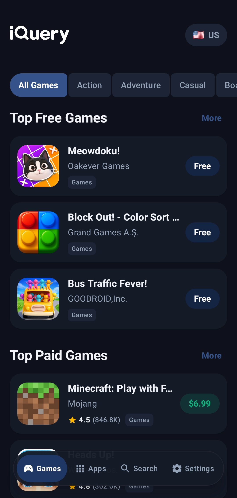
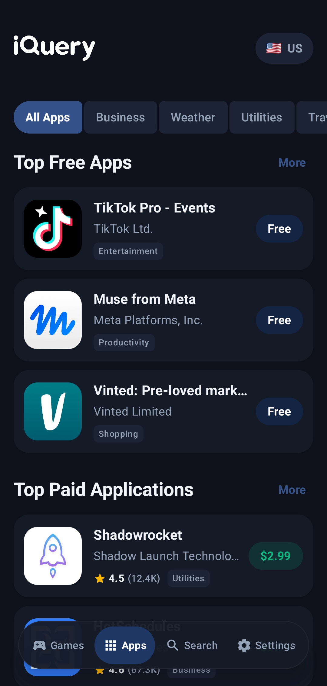
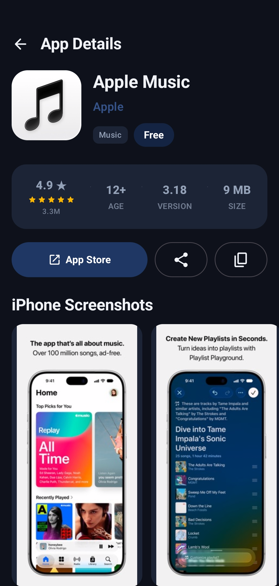
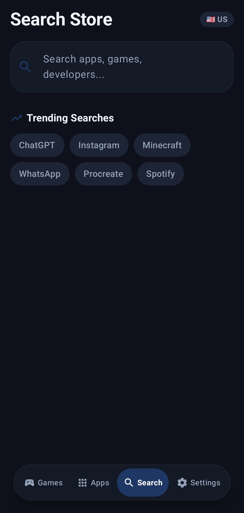
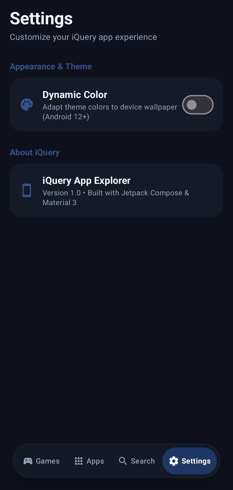

# iQuery

  

A native Android application for exploring Apple's App Store.

iQuery lets users search for iOS applications, browse app and game charts, view application details, and read customer reviews across different App Store storefronts.

iQuery is an independent third-party project. It is not affiliated with, endorsed by, sponsored by, or officially connected to Apple Inc.

## Features

- **App Charts:** Browse top free, top paid, and new applications.
- **Game Charts:** Browse top free, top paid, and new games.
- **Categories:** Explore applications and games by category.
- **Search:** Search for applications by name or keyword, with an option to filter for iPhone-compatible apps.
- **App Details:** View descriptions, screenshots, ratings, prices, version information, release notes, and supported devices.
- **Customer Reviews:** Read user reviews, ratings, and app versions, with pagination.
- **Developer Profiles:** Browse other applications published by the same developer.
- **Storefronts:** Browse App Store content from 175 supported country and region storefronts.
- **Official App Store Links:** Open an application's official App Store listing.
- **Settings:** Configure available app preferences, including dynamic colors.

## Screenshots

  
  
  
  
  

## Data Sources

iQuery uses Apple's publicly available iTunes APIs to retrieve App Store information.

The application uses the following endpoints and services:

- **Search API:** Search for applications.
- **Lookup API:** Retrieve application information.
- **RSS Charts:** Retrieve application and game charts.
- **Customer Reviews RSS:** Retrieve customer reviews.

API base URL: `https://itunes.apple.com/`

Application artwork, screenshots, descriptions, ratings, reviews, and other third-party content are displayed for informational and discovery purposes. Such content remains the property of its respective owners and rights holders.

iQuery does not claim ownership of Apple's services or the content retrieved through them.

## Independence and Trademarks

iQuery is an independent project developed separately from Apple Inc.

Apple, App Store, iPhone, and other Apple-related names and trademarks are the property of Apple Inc. Other application names, logos, artwork, and trademarks belong to their respective owners.

The use of these names and materials is for identification and informational purposes only. It does not imply any affiliation with or endorsement by their respective owners.

## Technologies

- Kotlin
- Jetpack Compose
- Material 3
- MVVM
- Kotlin Coroutines and StateFlow
- Retrofit
- OkHttp
- Kotlinx Serialization
- Coil
- Navigation Compose

## Requirements

- Android 8.0 (API 26) or later.
- Internet connection.

## License

The source code of iQuery is licensed under the Apache License 2.0. See [LICENSE](LICENSE) for details.

The Apache License applies to this project's licensed source code. It does not grant rights to third-party trademarks, artwork, screenshots, or other externally sourced content.

## Disclaimer

iQuery is provided as an independent application for browsing and discovering App Store content. Apple Inc. does not operate, maintain, sponsor, or endorse iQuery.

The application relies on publicly available services, which may change, become unavailable, or impose usage restrictions. iQuery does not guarantee the completeness or accuracy of externally sourced information.
